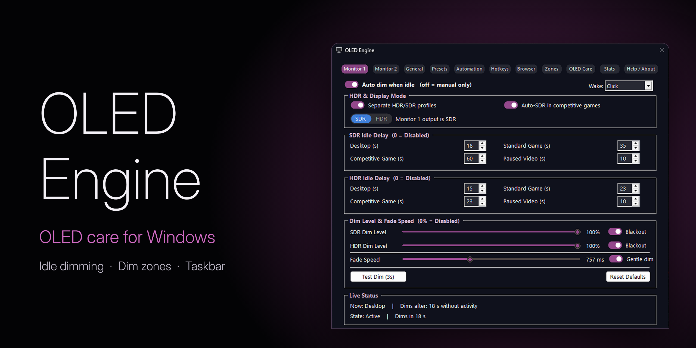

# OLED Engine

Multi-monitor OLED burn-in protection for Windows: per-category idle dimming and #000000 blackout, HDR/SDR profile switching, pixel refresh tracking, and game automation.

## Download

Get the latest version from the [Releases page](https://github.com/dxrksin/OLED-Engine/releases/latest). Download `OLED-Engine.exe`.

## Install

1. Create a folder somewhere you own, such as `Documents\OLED-Engine` or `C:\Tools\OLED-Engine`. Don't use `C:\Program Files`.
2. Move `OLED-Engine.exe` into it.
3. Run `OLED-Engine.exe`.

OLED Engine is portable. On first run it creates `config`, `logs` and `backups` folders next to the exe. Your settings live in `config`. To move the app, move the whole folder.

## Updating

Open **Settings > Help / About** and click **Check for Updates**. Your settings are kept. You can also tick "Check at startup" there.

## Game automation (optional)

Automatic G-Sync switching needs:

- [NVIDIA Profile Inspector](https://github.com/Orbmu2k/nvidiaProfileInspector) (a separate download)
- Your own G-Sync ON and OFF `.nip` profiles
- OLED Engine running as administrator

Set the paths on the Automation tab.

## Notes

- Windows may show a SmartScreen or antivirus warning for new unsigned apps. Each release lists a SHA256 hash you can check with `Get-FileHash .\OLED-Engine.exe` in PowerShell.
- Found a bug or have an idea? Open an [issue](../../issues).

## Building from source

Requires [AutoHotkey v2](https://www.autohotkey.com/) and its Ahk2Exe compiler. Compile `OLED Engine.ahk`. The files in `scripts\` are included automatically.
